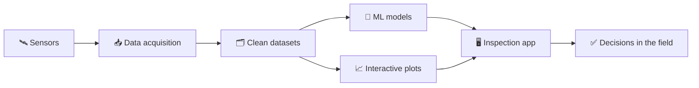

<div align="center">


<a href="https://github.com/Anubhavkumar31">
  
</a>

<br/>


</div>

---

## 👋 Hey, I'm Anubhav

```python
class Anubhav:
    role      = "Software Developer"
    education = "B.Tech, Computer Science (2025)"
    builds    = ["desktop apps", "ERP systems", "ML models", "data pipelines"]
    language  = "Python (mostly)"
    principle = "keep the raw data, say what was derived, never guess a number"

    def currently(self):
        return "shipping tools that people use every day at work"
```

I graduated in 2025 and went straight into building software that is used for real work. The code is mostly in private company repositories, so this page is the short version of what is behind them.

## 🏭 What I build at work

<table>
<tr>
<td width="33%" valign="top">

### 🖥️ Inspection software
A full desktop application in **Python and PyQt6** for pipe inspection: it reads sensor recordings, builds clean datasets, and draws the data so inspectors can see what is in it.

</td>
<td width="33%" valign="top">

### 🤖 ML on real data
**Machine learning models** trained on real inspection data and used in day-to-day pipe inspection work, not just notebooks.

</td>
<td width="33%" valign="top">

### 🏢 ERP application
An **ERP app** for the company I work at, covering the everyday business workflows of the team.

</td>
</tr>
</table>

> 🔒 These repositories are private, so there is no code to show here. I am happy to talk about how they work.

The shape of the inspection work, in one picture:



## 🛠️ Tech I use

<div align="center">

**Languages & desktop**<br/>


**Machine learning & data**<br/>

<br/>


**Web & tools**<br/>


</div>

## 🌱 Currently

- 🔭 Building and improving the inspection software and the ERP app at work
- 🧪 Making the ML models more accurate and easier to check
- 💬 Ask me about: Python, PyQt6, data pipelines, ML and deep learning on sensor data

## 🚀 Public projects

<details>
<summary><b>Click to see the ones I can share</b></summary>

<br/>

| Project | What it is | Built with |
| --- | --- | --- |
| [**TaskFlow**](https://github.com/Anubhavkumar31/TaskFlow) | A web app to manage tasks | JavaScript |
| [**yelpcamp**](https://github.com/Anubhavkumar31/yelpcamp) | A campground listing and review site | JavaScript |
| [**Shoe E-commerce front end**](https://github.com/Anubhavkumar31/Shoe-E-commerce-front-end) | A shop front end for shoes | JavaScript |
| [**Calorie burn prediction**](https://github.com/Anubhavkumar31/burn-calories-prediction-using-XGBooster-) | Predicts calories burned with XGBoost | Python |
| [**Parkinson's prediction**](https://github.com/Anubhavkumar31/parkinsons-disease-prediction-using-support-vector-machine) | An SVM classifier for Parkinson's disease | Python, Jupyter |
| [**Customer segmentation**](https://github.com/Anubhavkumar31/customer-segmenation-using-k-means-clustering) | Groups customers with k-means clustering | Python |
| [**Heart disease prediction**](https://github.com/Anubhavkumar31/simple-heart_disease_prediction-using-logisticRegression) | Logistic regression on heart disease data | Python |
| [**COVID SQL project**](https://github.com/Anubhavkumar31/covid_sql_project) | A SQL exploration of COVID data | SQL |

</details>

## 📈 Activity

<div align="center">


<br/><br/>

<picture>
  <source media="(prefers-color-scheme: dark)" srcset="https://raw.githubusercontent.com/Anubhavkumar31/Anubhavkumar31/output/github-snake-dark.svg" />
  <source media="(prefers-color-scheme: light)" srcset="https://raw.githubusercontent.com/Anubhavkumar31/Anubhavkumar31/output/github-snake.svg" />
  
</picture>

</div>

## 🤝 Let's connect

<div align="center">

[](https://www.linkedin.com/in/anubhavkumar32/)


</div>
